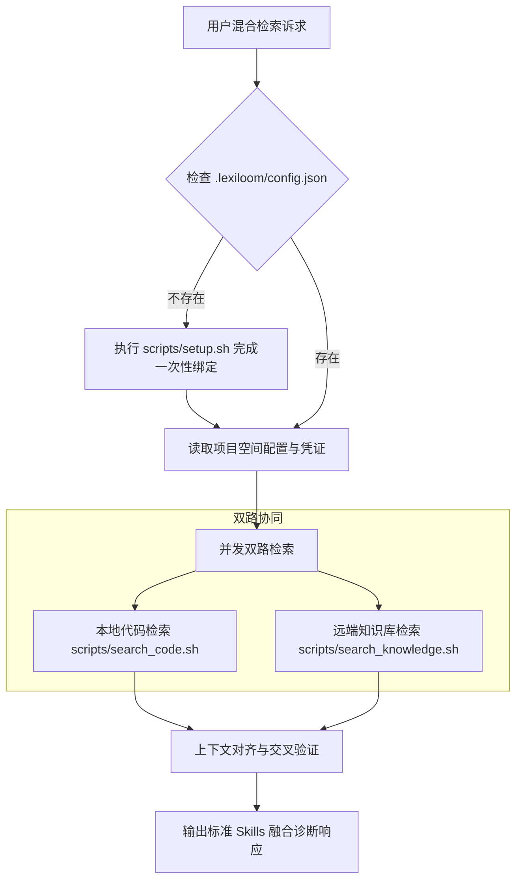

# LexiLoom 本地代码 + 知识库混合检索技能 (Hybrid Search Skill)

本技能为 **LexiLoom** 生态提供代码工程与知识中枢深度协同的能力。通过将本地实时代码上下文与远端结构化知识库切片进行对齐与交叉验证，精准回答“代码如何实现业务规则”、“设计方案与现有代码差异”等跨领域复杂问题。

---

## 核心流程全景



---

## 第一阶段：配置发现与环境检查

在检索前，按序执行以下检查：

1. **检查项目配置文件**：
   - 检查当前仓库根目录下是否存在 [`.lexiloom/config.json`](file:///.lexiloom/config.json)。
   - 检查是否存在私有凭证文件 [`.lexiloom.env`](file:///.lexiloom.env) 或环境变量 `LEXILOOM_API_KEY`。

2. **触发首次引导向导（若未绑定）**：
   - 若未检测到配置文件，调用 [`.agents/skills/lexiloom-hybrid-search/scripts/setup.sh`](file:///.agents/skills/lexiloom-hybrid-search/scripts/setup.sh) 引导用户一键绑定当前工程对应的 LexiLoom 工作空间 ID 与服务地址。
   - 确认 `.lexiloom.env` 已自动被写入 `.gitignore`，严防凭证泄漏。

---

## 第二阶段：双路并行检索执行

针对用户的自然语言提问（如 *“Token 统计接口的业务计算逻辑是什么？对应的领域设计文档是哪篇？”*），拆解关键词并执行并发检索：

### 路向 1：本地代码上下文检索 (Local Code Track)
运行脚本或执行 `ripgrep`：
```bash
bash .agents/skills/lexiloom-hybrid-search/scripts/search_code.sh "检索关键词"
```
* **优先扫描层级**：
  1. 控制器/接口契约层（`controller/`, `api/`）
  2. 领域服务与业务编排层（`service/`, `usecase/`）
  3. 领域模型与实体状态层（`entity/`, `model/`, `enums/`）
  4. 数据库持久化层与脚本（`repository/`, `schema_*.sql`）
* **提取要素**：定位关键类名、关键方法行号（`#Lxxx-Lxxx`）、核心逻辑实现片段。

### 路向 2：LexiLoom 知识库语义检索 (Remote Knowledge Track)
运行远端知识检索脚本：
```bash
bash .agents/skills/lexiloom-hybrid-search/scripts/search_knowledge.sh "用户问题自然语言"
```
* **检索范围**：受 `.lexiloom/config.json` 中绑定的 `workspace.id` 约束（支持服务端默认关联召回比例与 Rerank 策略）。
* **提取要素**：相关文档标题、所属分类、高置信度段落切片、视觉坐标（若存在）。

---

## 第三阶段：智能交叉对齐与融合分析

结合两路原始物料，执行如下逻辑验证：
1. **语义映射**：将代码中的字段名、枚举值与知识库文档中的业务专有名词建立双向映射（如代码中的 `del_flag` 对应文档中的“逻辑删除标记”）。
2. **一致性检查（Gap Analysis）**：
   - **完全吻合**：代码忠实落地了文档要求。
   - **文档滞后**：代码中已有新特性的扩展分支，但文档尚未提及。
   - **代码缺失/未覆盖**：文档明确规定的状态流转限制或边界异常，在代码中尚未包含卫语句拦截。

---

## 第四阶段：标准 Skills 响应规范 (Standard Output Specification)

每次完成混合检索后，**必须严格按照以下 Markdown 结构输出回答**，保证信息层次清晰、溯源精准：

```markdown
### 🎯 核心结论与技术概要 (Executive Summary)
> [!NOTE]
> [1~3 句话直击要害，概括该功能在代码中的实现位置与在知识库中的业务定义]

---

### 💻 代码实现溯源 (Code Implementation Trace)
* **核心类/组件**：[`XxxService.java`](file:///path/to/XxxService.java#L40-L65)
* **核心实现剖析**：
  ```java
  // 关键逻辑展示（保留精简代码）
  ```
* **调用链路走向**：`Controller` → `Query/Command Service` → `Repository / QueryDSL`。

---

### 📚 知识库设计与业务规则 (Knowledge Base Context)
* **依据文档**：📄 **《[文档标题](LexiLoom文档系统链接)》**（所属工作空间: `xxx`，匹配度: `xx%`）
* **规范约束摘要**：
  > “文档中关于此状态或逻辑的明确约定...”

---

### ⚖️ 融合对齐与差异诊断 (Code & Knowledge Gap Analysis)
| 检查维度 | 知识库规范要求 | 实际代码落地现状 | 一致性诊断 |
| :--- | :--- | :--- | :--- |
| **状态/参数定义** | 比如 APPROVED, PENDING | 对应枚举 `DocumentStateEnum` | ✅ 完全一致 |
| **异常分支拦截** | 业务要求非工作日禁止审批 | 未见 Guard Clause 拦截 | ⚠️ 代码待补充拦截 |

---

### 💡 建议与下一步行动 (Actionable Recommendations)
1. **代码改进**：如需补充卫语句或优化 QueryDSL 索引...
2. **文档同步**：如发现代码已有升级但文档未同步...
```
